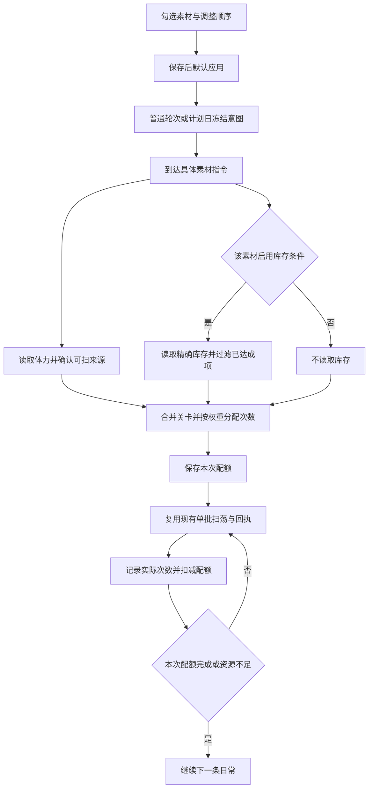

# 素材扫荡改造设计：勾选排序，按权重分配次数

2026-11-19 · 已实现于源码 · 自动验证与手工交接见 [验收记录](MATERIAL_PRIORITY_ACCEPTANCE.md)

## 1. 默认只选择要刷什么

将现有素材功能改为：**勾选素材 → 按选择顺序形成优先级 → 自动分配本次可用扫荡次数 → 按日程执行**。玩家不必填写库存目标，也不必手工决定每个关卡刷几次。

库存目标保留为每种素材可选的「达到库存后停止」。新添加的素材默认关闭；不开启时，库存、掉落数量和掉落概率都不参与次数分配。保存仍默认应用，查看目标表是可选步骤，保存不启动游戏。

### 五项需求的落地规则

| 需求 | 设计决定 |
|---|---|
| 默认仅勾选，不强制数量 | 新素材的库存停止条件关闭，没有必须填写的数量输入 |
| 按勾选先后确定优先级 | 最先选中排在最前；跨分类和搜索保留顺序；可拖动或上移／下移 |
| 按优先级安排，不考虑实际掉落 | 根据来源关系、可扫状态、可用体力和排序分配次数，不计算预期产量 |
| 自动权重，同关素材取最高优先级 | 关卡内统一执行优先级，权重取关联素材的最高值；同一关只分配一份次数 |
| 保留库存目标，默认不开启 | 每项独立启用库存停止条件；已配置的旧库存目标保留原有停止含义 |

**共同掉落只合并本次关卡行的执行优先级，不永久改写玩家排序，也不向其他关卡递归传播。** 这是本方案对第 4 项需求的具体解释，原因见第 4 节。

## 2. 实施前基线与改造位置

设计时核对的原实现如下；本次修改对应第 8 节的模块划分：

- [material_picker.py](../gui/material_picker.py) 的 `selection` 已维护逐次选择顺序，分类／搜索不会清空已选集合，可继续复用。
- [material_store.py](../core/material_store.py) 的 `save_targets()` 目前要求正整数库存目标，优先级仅有普通／优先两档；`remaining()` 依赖永久库存达成记录。
- [material_planner.py](../core/material_planner.py) 目前按优先级、缺口和单位体力预期收益贪心选择，不是按比例分配次数。
- [material_sweep.py](../module/material_sweep.py) 目前进入前读取目标库存，每批结束复读库存；确认消费和结算回执已分开保存。
- [plan_runner.py](../core/plan_runner.py)、日常任务行和首页目前会用共享库存目标是否达成修正素材结果，必须同时改为理解有限的次数计划。

本地目录版本为 `onestore-1.11.6-c312e4e`，包含 61 种素材、180 个普通关卡；这 180 关的单次成本均为 10 点体力，信用点出现在全部关卡中。这是本次设计的数据范围，不表示当前游戏已重新实机核验。已有 T5／信用点待补验标记继续保留。

## 3. 玩家操作与页面

### 3.1 选择和排序

继续使用现有分类、阶级、搜索和素材缩略图。选择卡片上增加本次选择序号，确认添加后按该顺序追加到列表末尾。

- 同一素材只能有一条定义，不能靠重复添加提高权重。
- 在选择器中取消后再次勾选，重新追加到本次选择末尾。
- 已添加素材的暂停／重新启用保留原位置；移除后重新添加则排到末尾。
- 手动排序后，以新顺序为准。筛选和搜索不改变顺序，也不按名称重新排序。
- 同一次批量选择没有逐次点击先后时，以该次可见顺序确定顺序；用户可立即调整。

### 3.2 默认列表不展示强制数量表单

素材窗口继续使用现有弹窗，不借此推进 UI 阶段 B 的主导航迁移。

```text
素材扫荡                         [+ 选择素材]
按排序自动分配次数，可拖动调整优先级

排序  启用  素材                 库存停止条件
 1    ☑    [图] T2耳环兑换券     未启用
 2    ☑    [图] T2帽子兑换券     未启用
 3    ☑    [图] T2项链兑换券     达到 50 个后停止

[保存并应用]                    [查看扫荡安排]
```

选择某行的库存停止条件后，才展开「达到库存后停止」开关与数量输入。最近库存、缺口、重新开启和手工库存纠正放在这项设置旁；没有启用库存条件的素材，不显示“库存待同步”作为运行障碍。

沿用原任务 ID `mad.material_sweep`。新增指令的默认显示名建议改为「素材扫荡」，用户已重命名的指令不自动改名。

### 3.3 安排表解释次数来自哪里

默认列为：关卡、关联素材、执行优先级／权重、计划次数、已完成／剩余、体力、安排原因。移除默认的预计产出列。

- 页面顶部明确普通日常或计划日期，以及具体指令实例。
- 未开始时显示依据最近可扫状态和体力生成的预览；未知数据明确待读取，不伪造次数。
- 未来日期只显示素材排序、约束和可选来源；执行当天才读取资源并分配次数。
- 已开始时显示已保存的本次安排和真实完成次数，不因刷新页面重算配额。
- 同关素材标明「按本关最高优先级一起安排」。基础排序仍在共享列表中可见。
- 保留指定来源、排除来源、本轮最多次数和恢复自动；这些是可选调整，不成为默认流程的必经步骤。

沿用现有同步入口：纯次数模式显示「刷新可扫关卡和体力」，有库存条件时同时读取相关目标库存。该按钮明确会连接游戏；浏览素材和查看已有安排不会自行连接。

## 4. 优先级与权重

### 4.1 顺序决定基础权重

本轮启用的素材有 M 项，按玩家排序编号 r=1…M：

`基础权重 w = M - r + 1`

三项就是 3∶2∶1，四项就是 4∶3∶2∶1。使用线性权重，避免指数权重让低优先级素材长期分不到次数；首版不增加权重编辑器或多套分配算法设置。

无可扫来源、已达库存目标、库存条件尚无法核对、主动次数上限为 0 的素材不参与本次分配。其他素材保持本轮基础权重，再在可执行关卡间归一化；临时不可扫不会改写玩家排序。

### 4.2 同关卡使用最高基础权重

对已选入本次安排的关卡 s，取在该关允许主动安排的关联素材集合 R(s)：

`关卡权重 W(s) = max(w(i), i ∈ R(s))`

这些素材在该关卡行内按同一最高优先级执行；关卡只分配一份次数。**取最大值，不把权重相加，也不把一次扫荡计算成多次体力消费。**

挑选初始关卡时，每项最多指定一个主刷来源；多个素材主刷来源相同则合并。这不妨碍素材关联其他已经入选且允许使用的共同来源。安排表列出这些共同来源，使用原始基础权重确定各关执行优先级，不拿上一关推导出的优先级再次提权。

手动指定来源或排除来源导致某素材不能在该关主动安排时，它只能作为附带可能获得的素材，不参与该关提权或占用它的主动额度。未勾选、暂停或已停止的素材同样不参与提权。

### 4.3 为什么不全局递归提权

假设 A 与信用点在关卡 S 共同掉落，B 与信用点在 T 共同掉落。若先把信用点永久提升到 A 的优先级，再把这个新优先级传播给 B，低优先级信用点会把无关素材全部拉到最高级。当前 180 个关卡都有信用点，这个问题会普遍发生。

因此同时保留两种不同含义：

- **基础顺序**：玩家的意图，只有玩家排序才改变。
- **关卡执行优先级**：这次同关素材共享的派生值，仅对该行安排生效。

若玩家主动把信用点本身排在第一位，各含信用点关卡直接获得高优先级是正常结果；这里只阻止间接循环提权。

## 5. 生成关卡和次数

### 5.1 选来源不比较掉率

1. 从现有素材来源表取得候选关卡，排除不允许的来源、无效掉落关系及当前不可扫关卡。
2. 手动指定来源优先；指定关卡不可扫时提示该项，不能擅自换成自动来源。
3. 自动素材按基础优先级依次处理，优先复用已经选中的可用来源。
4. 需要新增来源时，优先选择能同时覆盖更多尚未安排目标权重的关卡，再比较单次成本，最后按关卡编号稳定选择。
5. 将相同关卡合并，再按第 4 节生成各关的共同执行优先级。

第 4 步的覆盖权重仅用于挑选来源；分配次数仍取同关最高权重，不对共同掉落重复加权。没有掉落概率或数量估计也可以安排；但必须有适配目录中的来源关系和可扫确认，不能推测未解锁关卡。

### 5.2 默认总次数来自实际可用体力

不新增必须填写的总次数。沿用每条素材指令的保留体力：

`本次可用体力 B = max(0, 当前体力 - 本条保留体力)`

当前适配的普通关卡单次均为 10 点体力，因而 `本次总次数 N = floor(B / 10)`。实现仍从关卡目录读取成本；不改普通扫荡的 MAX 和剩余计划。

资源到这条指令真正执行时再读取。首扫与领奖后尾扫分别按各自到达时的体力规划；不购买体力、不吃恢复道具，也不把未来一周的资源提前透支。

### 5.3 按比例分配整数次数

无额外约束时，关卡 s 的理想次数为：

`q(s) = N × W(s) / ΣW`

先向下取整；剩下的次数按小数余数从大到小补齐。余数相同，优先级更高的先分，再按关卡编号稳定处理。分配总次数不超过 N，总体力不超过 B。

小预算不保证每项至少一次。例如总共只够两次，3∶2∶1 分为 1、1、0；低优先级项显示本次未分配，不额外补充体力。

存在主动次数上限或可扫次数限制时，先限制相关额度，再将无法使用的份额分给其余仍可执行的需求。额度用尽的素材不再贡献主动权重，不会换一个关卡补回它的主动次数；它仍可能随其他素材获得共同掉落。这与原本「本轮最多」的含义一致。

现有素材上限继续跨关卡、按本轮及指令实例累计。同一实际扫荡只消耗一次总预算，但可以同时扣减多项主动关联素材的剩余额度；仅附带获得的素材不另算主动额度。

### 5.4 可核算示例

独立三项、权重 3∶2∶1、总共 10 次，安排为 **5、3、2 次**。

共同掉落示例：仅考虑已确认可扫的 NORMAL 4-1、5-1，玩家顺序为耳环、帽子、项链、信用点，基础权重分别为 4、3、2、1。当前体力 160，保留 20，共可扫 14 次。

| 关卡 | 所选素材的共同来源 | 执行优先级 | 权重 | 分配次数 | 体力 |
|---|---|---:|---:|---:|---:|
| NORMAL 4-1 | T2耳环兑换券、T2项链兑换券、信用点 | 1 | 4 | 8 | 80 |
| NORMAL 5-1 | T2帽子兑换券、信用点 | 2 | 3 | 6 | 60 |

项链和信用点在 4-1 随耳环使用优先级 1；5-1 仍取帽子的基础优先级 2，不能因信用点在另一关被带到优先级 1 而变成 1。实际掉落为零或远超预期，都不改变这份次数安排。

## 6. 可选库存停止条件

每种素材可单独打开「达到库存后停止」，支持与未开启库存条件的素材混排。这里的数量仍指**最终库存**，不是新增获取量。

- 开启后才要求正整数目标。执行前读取该项精确库存；未知不当零，仅暂停这项主动安排，其他仅按次数分配的素材仍可运行。
- 库存只用于决定这项是否继续参与，不参与权重、收益率或缺口比例计算。
- 已达到目标时退出主动分配，保留原先“达成一次后停止，后来消耗不自动补货”的语义；「重新开启」沿用原功能。
- 关闭库存条件时，可保留此前填写的数量供下次使用，但它不生效，也不因旧达成记录阻止扫荡。重新启用未修改的旧目标，仍显示原达成状态；需要再补货时使用重新开启。
- 所刷关卡会掉落某个尚未完成的库存目标时，该批采用单次扫荡并复读该目标库存；纯次数分配批次继续最多 5 次。这样不需要靠预计掉率决定临近达标批量。单次产出仍可能超过缺口。
- 某库存目标中途达标后，撤销仅为它保留的未执行份额，按其他仍有效需求重新分配剩余预算；不增加本次总预算。所有库存目标都达标且没有持续勾选项时提前结束。
- 实际次数先登记；库存读取失败不会抹掉已确认次数或使该批再次消费。其他素材继续与否由其自身条件决定，未知库存不扩成全局故障。
- 只刷新体力／关卡时，不更新未读取库存的观察时间；历史库存只能显示为历史值，不能替代库存条件开启后的执行前读取。

旧目标功能的“达标停止、完成记忆、重新开启”保留；新轮次的次数选择统一改为权重分配，不再沿用旧的缺口收益率优化。已经冻结的旧轮次按第 9 节继续旧规则。

## 7. 执行、重算与恢复

### 7.1 保存选择与冻结次数是两件事

仍在普通轮次／计划日开始时冻结素材选择、基础排序、库存条件和临时规则。**每条素材指令真正到达时**才读取资源、生成并保存有限的次数安排。



普通批次结束只扣减本次配额，不从剩余体力重新发一份完整比例表，否则每次五连扫都会偏向高优先级。正常等待、刷新 UI、停止后继续都不重新配额。

只在已选关卡实际不可扫／次数用尽、库存条件或主动额度变化时重排未执行部分。重排配额不超过“初始预算减去已确认消费”；实际批次再取该剩余预算与当前可用体力的较小值。体力减少只限制当下执行，不删除次数债务。出现新体力也不扩充已开始的配额，后续尾扫或下一次正常调度再规划。

体力减少只缩小当下可执行部分，不取消原来未完成的配额：原计划 10 次、实际完成 6 次时，剩余 4 次仍待续。只有目标已达成等明确取消需求的条件才撤销对应未执行份额，不能把资源不足重算成“全部完成”。

### 7.2 每次执行有独立配额，重试沿用同一份

配额身份使用现有执行语义：素材上下文、根指令、pre/main/post 位置、指令实例、同位置出现序号，以及持续运行的调度周期。不能只按素材或 `instance_id` 存一份配额：同一实例可能在持续运行中再次到期，也可能由跟随关系调用。

`MadThread.run_group()` 已掌握 token 和周期，可把这个只读身份交给素材模块，无须另建调度器。

- 中断后回到同一步：沿用未完成配额与回执。
- 后续尾扫：新的执行身份和当时资源，独立安排；不复制首扫已经完成的次数。
- 持续运行再次正常到期：新调度周期、新配额，原有本轮手动上限仍按原范围累计。
- 计划「仅续做余项」：继续当天未完成配额或尚未达成的库存条件，不因为素材还勾着就无限续刷。
- 配额已执行完、库存目标仍有余项时，玩家显式「仅续做余项」会产生一个库存条件专用的后续配额；关闭库存条件的素材不重新分配。仅有次数债务时沿用原身份，不产生新配额。
- 新游戏日不积累昨天未分配的比例欠账；日切和冻结规则沿用现有计划执行器。

### 7.3 消费回执继续作为安全边界

确认前持久化批次 ID、配额身份、关卡及请求次数；结果出现后记录实际次数，原子扣减相关配额与主动额度。批次最多结算一次。

- 已看到次数、后续读取失败：结算已知次数，不重放。
- 是否消费不明：保持现有全局待核对保护，任何新素材指令或新轮次都不能绕过。
- 玩家确认未执行：恢复同一份未消费配额。
- 玩家确认已执行但次数不明：记录未知，结束受影响指令的本轮额度，不猜测次数、不补发配额；后续不同指令在核对完成后再规划。

### 7.4 结果以本次安排为准

| 条件 | 显示与后续 |
|---|---|
| 已执行全部分配次数 | 已完成本次安排；素材仍保留勾选，下次正常调度可继续 |
| 未勾选任何项 | 已跳过：未选择素材 |
| 纯次数模式开始时没有可用体力 | 已跳过：本次无可分配次数，不生成无限余项 |
| 部分素材没有可扫来源 | 明确列出未参与项；其他素材照常分配，不说所有素材已达标 |
| 已保存计划 10 次，实际只能完成 6 次 | 完成 6、保留 4；结束本功能并继续后续日常 |
| 所需体力／可扫数据读取失败 | 本次待处理，停止该次分配并继续后续任务；恢复时先补读数据 |
| 开启库存条件且仍未达标 | 保留该库存目标的余项含义 |
| 消费结果不明 | 待核对，不自动再刷 |

任务、首页及计划日汇总使用同一查询，分别判断本次配额余项、有限库存目标余项、数据待处理和消费待核对。普通勾选素材本身不等于“尚未完成的库存目标”；尾扫达到库存目标也不能顺手清除另一条指令未完成的独立次数配额。

## 8. 轻量数据和模块设计

### 8.1 定义与派生数据分开

继续使用 `material-goals.json`，增加独立的素材定义格式版本；不为此提升普通任务配置 schema。

- `targets` 数组顺序是唯一的基础排序来源，不另存点击时间和可漂移的排序编号。
- 每项保留 `ref`、`enabled`、`excluded`、`amount`、`version`，新增 `stock_limit_enabled`。
- 新项 `stock_limit_enabled=false`，`amount` 可以为空；开启后才校验正整数。不能用 999999 等假目标代表“未设数量”。
- `version` 继续服务库存目标的达成记忆；调顺序、暂停或改权重不清掉完成记录。
- 权重、关卡执行优先级和预览次数均为派生值，不写回玩家意图。

现有 `material-state.json` 的观察、完成记录、手动调整、pending 和 receipts 继续保留。轮次内新增按执行身份索引的配额：策略版本、初始预算、已保存关卡次数、已确认次数及必要的待处理原因。回执附带所属配额身份。当前按实例累计的手动次数额度继续保留，不随新调度配额重置。

### 8.2 代码职责

| 模块 | 修改内容 |
|---|---|
| `gui/material_picker.py` | 复用选择顺序，显示顺序编号，覆盖取消再选与跨分类行为 |
| `gui/fragments/materials.py` | 默认无数量表单、排序、可选库存条件、按次数展示安排，保留临时调整 |
| `core/material_store.py` | 格式兼容、意图快照、配额与回执原子结算、按执行身份查询余项 |
| `core/material_planner.py` | 纯函数生成来源／同关优先级／整数次数分配；不操作设备或落盘 |
| `module/material_sweep.py` | 分离可扫状态／体力观察和可选库存观察，消费已保存配额 |
| `core/Mad_thread.py` | 向素材执行传递现有步骤 token／调度周期；事件带回配额身份 |
| `core/plan_runner.py`、任务行、首页 | 用统一的配额／库存余项判断代替全局 `remaining(snapshot)` 推断 |
| 素材测试与使用文档 | 按新模式补齐测试，更新文案；保留旧目标停止及消费保护回归 |

只扩展现有模块。不上通用优化求解器，不新增数据库、账户接口、后台服务或第二套执行引擎。

## 9. 升级与旧配置

1. 新配置、新添加素材默认仅按优先级分配，库存条件关闭。
2. 旧定义已经有明确数量，迁移时视为库存条件开启，保留数量、版本、启用状态、排除来源和达成记录。不能因为新版默认值让原本有限的需求突然变成持续消耗体力。
3. 旧两档优先级转换为“原优先项在前、普通项在后”，同档保持原数组顺序；之后由玩家排序控制。
4. 提供「更多 → 全部关闭库存停止条件…」，确认后将不再按库存停止；数量、其他配置和历史回执保留，保存后生效。不要求玩家逐项清空数字。
5. 新定义供后续轮次使用；已有冻结快照及待核对回执不改写。没有新策略版本的冻结轮次继续原库存规划逻辑，完成后新轮次才切换。
6. 首次实际保存新格式时备份旧定义；迁移幂等、原子保存并保留 revision 冲突检查。备份不是重置消费进度的工具，不能用旧状态覆盖后续已产生的回执。
7. 新版读取旧格式兼容；旧程序不理解新“数量关闭”的格式。升级后同一数据目录只由新版管理，不能交替用旧启动器编辑。手工测试先用隔离配置验证迁移，再应用到原配置；正式回退需处理格式兼容，不能只换回旧程序并恢复旧进度。

原来已经设置库存目标的玩家会继续看到它；新默认值不会强行覆盖已有意图。此次是默认交互和分配策略的明确变更，不是简单将原数量框藏起来。

## 10. 实施和验收

推荐按“存储与纯规划 → 执行与恢复 → 界面与回归”完成同一个功能，不先做一个没有真实配额约束的 UI。

验收必须覆盖：

1. 新建三种素材，不输入数量即可保存；关闭库存条件时完全不调用库存 OCR。
2. 先选 B、再选 A、跨分类选 C，保存重开仍为 B/A/C；取消重选、暂停恢复和手动排序遵守第 3 节。
3. 3∶2∶1 的 10 次分为 5/3/2，2 次分为 1/1/0；确定性、整数总量和体力约束正确。
4. 同关采用最高权重、只消费一次预算；信用点不造成递归提权；选择器和安排表能解释共同优先级。
5. 修改库存、实际掉落数量或公开掉率，不改变纯次数模式的安排；来源和可扫状态变化可以改变安排。
6. 指定／排除来源、0 次及有限上限、共同掉落、部分关卡不可扫，不绕过约束或重复计算额度。
7. 普通批次之间不重发配额；停止重启、自然完成后再次运行、持续调度、跟随调用、首扫与尾扫的执行身份正确。
8. 计划 10 实际 6 后继续后续功能，恢复只处理剩余 4；日切不把昨日比例欠账累加到今天。
9. 混合库存条件时达标项停止、其余项继续；未知库存只影响相关项；永久达成、重新开启和手工纠正原有语义正确。
10. 确认前崩溃、确认后结果未知、结果已见但库存失败、重复 settle，均不重复消费；待核对不能由新轮次绕过。
11. 旧定义迁移前后量、版本、达成状态和冻结内容一致；重复读取／保存迁移不会再次改变顺序或清空回执。
12. 日常／计划／首页用一致的有限余项判断，纯勾选模式不会永久显示“素材未达标”。分类缩略图、键盘排序、浅深色及小窗口可用。

实现与自动测试使用隔离配置和替身游戏操作；本轮未连接 MuMu 或修改原玩家配置、进度。实际游戏由用户以自行确定的小额度手工验收，测试证据及入口见 [验收记录](MATERIAL_PRIORITY_ACCEPTANCE.md)。
