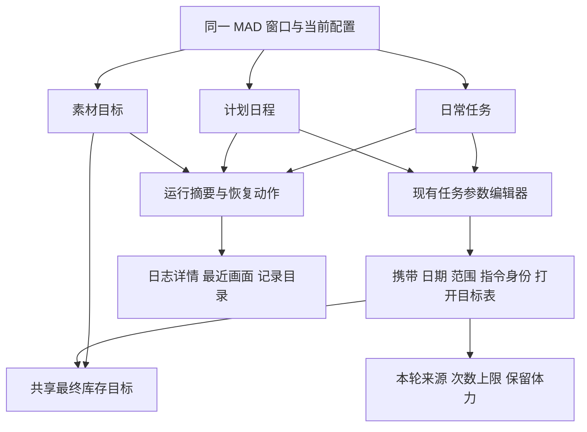
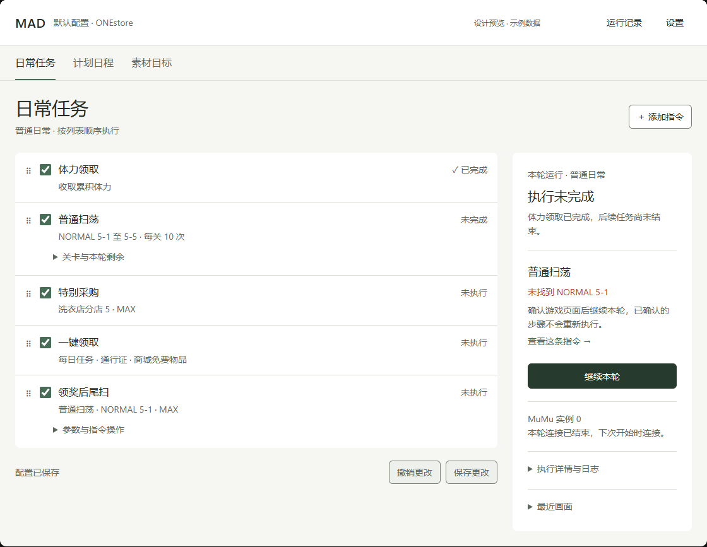
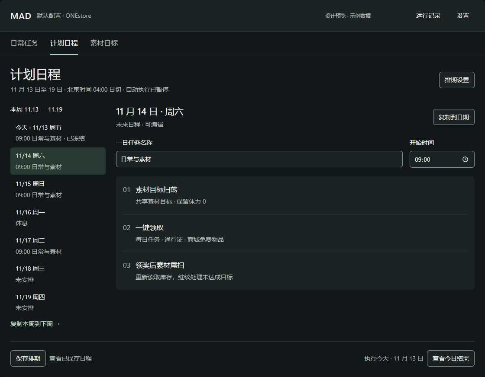
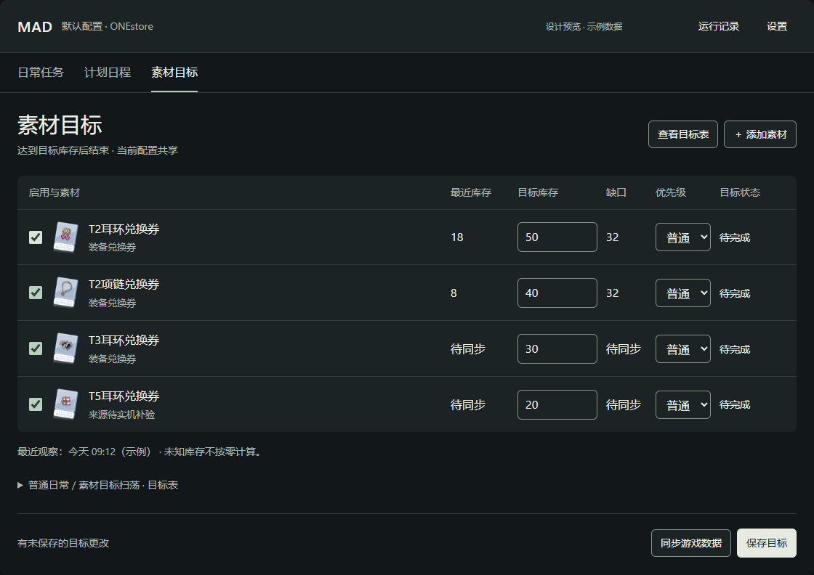
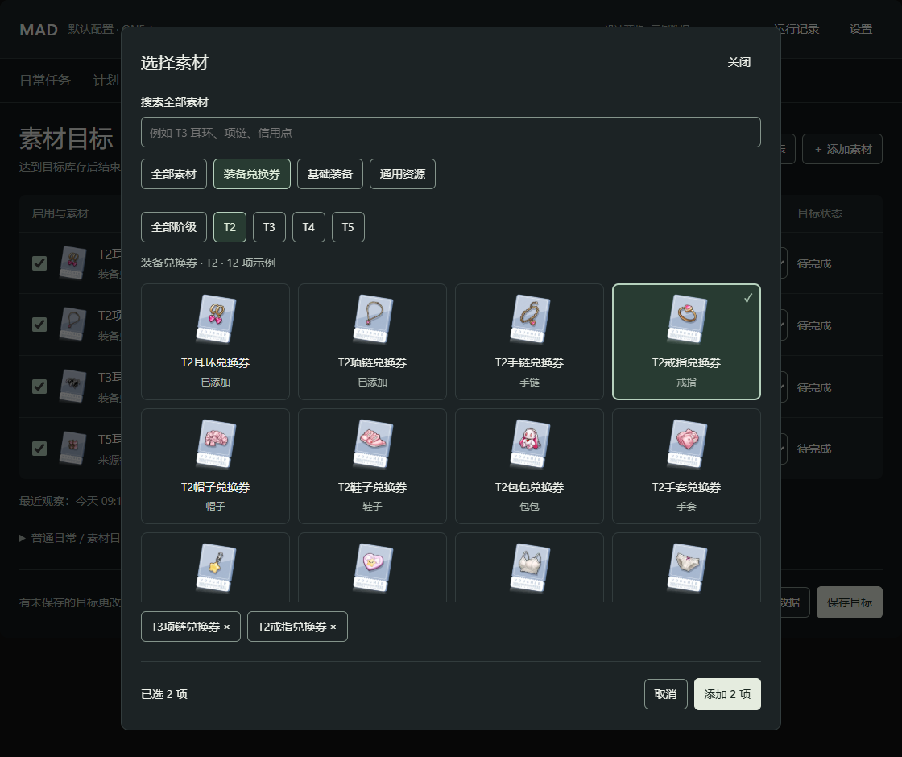

# MADAutoScript UI 优化方案

方案版本：0.1.0 · 2026-11-13 · 状态：阶段 A 已实现并通过自动验证，待用户手工测试；阶段 B／C 待实施

## 1. 推荐方向：保留操作习惯，改成任务优先的工作台

采用 **暖白／石墨、低饱和绿强调、清晰字号层级、轻量列表、结果先于日志** 的方向。继续使用 PyQt5、PyQt-Fluent-Widgets 和现有原生控件，不迁移 Web，不重写执行框架。

本次最重要的三个使用场景：

1. 打开 MAD，确认执行哪份日常，一次开始；发生失败时直接看到原因和恢复入口。
2. 设置素材的最终库存，保存即用于规划；需要时再查看或调整某一条指令的目标表。
3. 安排未来一周，清楚区分正在编辑的日期、真正执行的今天，以及已冻结的历史。

优化覆盖日常工作台、任务参数、运行状态、计划、素材目标与选取、设置、持续运行调度、相关弹窗。运行记录继续提供现有目录入口，不新增日志数据库或统计后台。

### 规范来源与本轮边界

用户给出的 `C:/Users/za/Documents/Codex/ui-standards/v1.1.0/` 当前不存在。已核对对话「评估 awesome-design-md 作为 UI 标准」：该目录是拟归档位置，尚未执行归档。实际读取的是同一对话已完成的 v1.1.0 文件：

- [跨项目 UI 规范 v1.1.0](C:/Users/za/Documents/Codex/2026-11-11/https-github-com-voltagent-awesome-design/outputs/UI_STANDARD.md)
- [DESIGN.md 模板](C:/Users/za/Documents/Codex/2026-11-11/https-github-com-voltagent-awesome-design/outputs/DESIGN.template.md)
- [已认可 demo 的方向与检查记录](C:/Users/za/Documents/Codex/2026-11-11/https-github-com-voltagent-awesome-design/work/STUDIO_DEMO_CHECKS.md)

采用其排版、留白、交互连续性和原生平台条款；在两套可选配色中选择暖白／石墨，因为它能延续 MAD 已有的绿色识别，而不继续让所有表面都泛绿。[awesome-design-md](https://github.com/VoltAgent/awesome-design-md) 保持视觉参考库的角色，不另选品牌模板覆盖已定方向。没有复制上游品牌图像、字体或 Logo。

阶段 A 获批实施后，已建立项目 [DESIGN.md](../DESIGN.md)，并将实际读取的 v1.1.0 基线固定保存为 [UI_STANDARD_v1.1.0.md](UI_STANDARD_v1.1.0.md)。全局规范入口不变。下文仍保留完整目标设计，具体实施范围与证据见 [阶段 A 验收记录](UI_STAGE_A_ACCEPTANCE.md)。

## 2. 当前界面的实际问题

基于当前本地 0.8.0 源码、既有便携包截图，以及隔离配置下重新渲染的计划、素材、设置和调度页面。新截图使用示例配置，未连接模拟器。

| 当前表现与依据 | 对使用的影响 | 设计决定 |
|---|---|---|
| 首页标题 14、任务名 14、摘要 13、提示 12，主次差别很小；每条任务均为有边框圆角卡片 | 页面很满，但难以先看到重点 | 标题与任务名建立明显层级；任务改为连续列表，只有展开编辑区需要独立表面 |
| 任务名按 196 宽度截断，参数与名称挤在一行；完整值主要依赖悬停 | 重复指令、自定义长名称不易区分 | 名称和参数上下两行；提供可聚焦的参数展开入口，完整内容不只靠悬停 |
| 右侧日志始终占据最大面积；异常堆栈也进入简要日志 | 玩家先读技术信息，仍不知道下一步 | 运行面板先显示对象、结果、问题、恢复操作；日志成为后续详情 |
| 首页开始按钮会随计划自动执行状态改为执行今日计划，但旁边仍是普通日常列表 | 眼前配置与实际执行对象可能不同 | 所有启动入口明确对象；自动计划开启时，普通日常页面不再显示模糊的「开始／继续」 |
| 计划与素材通过模态窗口进入，素材选取再叠一层弹窗 | 高频切换容易迷失当前日期、指令和目标范围 | 计划与共享素材目标逐步升为同一窗口的主页面；短操作继续用弹窗 |
| 计划页仍混用原生 QLineEdit／QCheckBox／QTimeEdit 与 Fluent 控件；隔离实渲中可见深色页上的白色输入与深色标签 | 深色主题不一致，部分标签难读 | 用现有主题适配标准控件，避免只给 QDialog 选择器套局部样式 |
| 浅色辅助文字 `#7b857f` 对页面 `#f9faf9` 约 3.65:1，对白色约 3.82:1 | 辅助信息过淡 | 更换辅助文字 token；正文、摘要、错误均按可读文字验收 |
| `#e5eae6` 对白色仅约 1.22:1，却也用于部分输入边界 | 装饰线和控件边界职责混淆 | 分离装饰分隔与控件边界，不要求所有细线都同样醒目 |
| 素材目标未同步时，库存显示待同步，但状态列仍可显示「进行中」；验证标记也占用同一状态列 | 不清楚是目标在执行，还是数据待补全 | 将目标状态、数据新鲜度、来源验证三种信息分开表达 |
| 设置所有字段挤进一个展开卡片，标签与输入左右距离大；保存与反馈位于滚动内容末尾 | 字段关联弱，长窗口中操作易被挤出首屏 | 按设备、时间规则、外观分组；对话框固定底部动作区 |

素材分类选取已经具备类别、阶级、全局搜索、跨分类多选和 61 张图标，方向正确。继续精修，不退回长下拉菜单，也不另造素材浏览器。

证据目录：[现状截图与检查](../artifacts/ui-design-20261113/)。当前首页／选取器的有效既有截图：[工作台](../artifacts/release-0.7.5-20261113/portable-workspace.png)、[素材选择](../artifacts/release-0.7.5-20261113/portable-material-picker.png)。两图的功能界面与本地 0.8.0 相同，仅版本元数据此前不同。

## 3. 必须保持的业务含义

- **同类指令可重复，身份以 instance_id 区分。** 重命名、选中和排序不能改成按标题或功能类型关联状态。
- **普通扫荡继续处理剩余计划。** MAX 仍指游戏当前允许次数；体力不足时执行可执行的最大次数，结束这一扫荡功能，再继续其他功能。不因界面调整补充体力或重置余项。
- **开始新一轮不是继续。** 保留单独入口并说明将重建完整计划，不作为故障恢复的默认按钮。
- **素材目标是最终库存，不是新增获取量。** 达成一次后停止补货；未知库存不当零；保存默认应用，但保存不启动游戏消费。
- **素材共享目标与指令临时调整分离。** 目标属于配置；保留体力属于指令；来源与本轮上限属于 scope + instance_id。复制任务不复制库存、回执、临时调整或达成进度。
- **计划日首次启动冻结。** 当前冻结日只读；未来日期仍可编辑；复制日期和整周不复制执行进度。
- **计划的游戏日、开始时间、时区保持原义。** 早于日切的钟点显示次日，不把游戏日偷偷换成自然日。
- **待核对不能直接重试。** 已消费与否不明时，先核对，再调用现有恢复路径；不能为了按钮简洁自动重放。
- **同一配置只有一条执行通道。** 素材同步也使用现有运行锁；浏览目标、看日志、切换页面不触发 ADB。
- **关闭窗口不等于后台继续。** 当前实现请求停止并等待退出；计划依赖工作台运行。此次不增加托盘常驻、开机启动、自动更新或新执行引擎。

## 4. 信息架构与布局

### 4.1 同一窗口三项主导航

主导航用文字标签 **日常任务 / 计划日程 / 素材目标**，放在顶栏下或与顶栏自然并排；不增加宽大的固定侧边栏。1120 级窗口更需要内容宽度，而不是给三个入口单独分配 200 宽的导航列。

- 顶栏：MAD、当前配置名；右侧「运行记录」「设置」。配置名当前是标签，不伪装成尚未实现的多账号选择器。
- 日常任务：普通指令列表和参数；右侧运行面板。
- 计划日程：一周日期列表、选中日配置、当天执行状态。
- 素材目标：共享目标；从某条指令进入时带上该指令的目标表上下文。
- 持续运行设置：保留原顶栏「调度」入口兼容已有习惯，明确命名「调度／持续运行」；同时在持续运行菜单中提供同一入口，不新建第二份设置。
- 运行记录：仍打开最近记录目录或 runs 目录。计划日继续保留当日结果与配置快照查看，不把两个范围混成一种记录。

旧「计划」按钮、任务内「编辑目标／查看目标表」保留为到对应页面的入口。页面切换不保存、不执行、不清除草稿；返回保持日期、指令、滚动位置和展开项。

### 4.2 尺寸按 Qt 逻辑坐标设计

- 保留当前 **1120×760 默认窗口、980×680 最小窗口** 作为主要验收档位，不强迫用户换大屏。窗口不能超过系统可用区域。
- 日常页宽度足够时：任务区弹性，运行区约 300–320，区域间距 24，页面左右边距 24。参数编辑获得至少约 600 宽，而不是缩小字号硬塞。
- 可用内容宽度不足以同时保留上述两区时，运行区收敛为上下文状态带＋「展开运行详情」。停止／继续入口仍可见；展开内容在内容区呈现，不增加第三个窄栏。
- 计划页保留约 220–240 宽的纵向一周日期表，右侧编辑日期；不新增月历、无限画布或拖拽时间轴。窄窗口把日期变成可选择的紧凑列表，不压缩任务名称。
- 素材页表格优先占满内容宽度；关联说明折行，次要元数据进入行详情。真实二维数据必要时只让表格局部横向滚动。
- 矮窗口中，只滚动任务／表单正文。页面标题、当前范围、保存／执行操作不随正文一起消失。弹窗高度以 availableGeometry 为上限。
- 目标验证 Windows 100%、125%、150% DPI；200% 或可用区域小于最小值时采用单列／内容滚动回退，不把小屏当成拒绝启动的条件。原生适配不承诺网页 320 CSS px 规则。

## 5. 视觉系统

### 5.1 颜色

保留浅色、深色、跟随系统三个现有选项；主题仍在设置中统一保存。采用下列候选值，实现后以 `gui/theme.py` 为唯一数值来源，文档保留语义和使用规则。

| 语义 | 浅色 | 深色 | 用途 |
|---|---|---|---|
| 页面底色 | `#F6F7F3` | `#121719` | 大面积中性背景 |
| 内容表面 | `#FFFFFF` | `#1C2325` | 列表、编辑区、弹窗 |
| 次级表面 | `#EEF1EB` | `#252E30` | 分组与悬停 |
| 正文 | `#242B25` | `#EDF0E9` | 名称、数值、说明 |
| 辅助文字 | `#5F695F` | `#ACB7AF` | 摘要、时间、次要说明 |
| 装饰分隔 | `#DCE1D7` | `#323C3D` | 列表细线，不充当输入边界 |
| 控件边界 | `#788172` | `#84948B` | 必要的可操作边界 |
| 主操作底／字 | `#263B2E` / `#FFFFFF` | `#E5ECDF` / `#1A2720` | 每个独立区域的关键动作 |
| 主操作 hover／pressed | `#354D3E` / `#192A20` | `#FFFFFF` / `#CBD8C4` | 文字色不变，尺寸不变 |
| 品牌强调 | `#476D57` | `#B6D1BD` | 当前导航、选中标记，不代表成功 |
| 选中底／字 | `#E6EDE1` / `#234632` | `#283B32` / `#E1EFDC` | 成对使用 |
| 焦点 | `#246743` | `#C0DC9C` | 保留可见焦点与背景间隔 |
| 成功 | `#286443` | `#9BCEAE` | 小图标＋文字 |
| 警告 | `#89581D` | `#E4C28D` | 余项、待核对、待补验 |
| 错误 | `#AC3D32` | `#EFA99E` | 失败与危险操作文字 |

状态默认不铺满彩色卡片；只有当前需要处理的问题可用低强度背景。禁止用「绿色」同时代表启用、正在执行和成功而无文字区分。禁用与只读分开：运行时不能改的参数仍可读取、选择和复制。

候选值计算：浅色辅助文字对页面／内容表面约 5.31:1／5.72:1，深色约 8.73:1／7.71:1；控件边界对内容表面分别约 4.05:1／5.01:1。实现时仍需检查选中、悬停、禁用和焦点叠加后的实际颜色，不能只验收静态 token。

### 5.2 字号与形状

候选字号使用 QFont point size 与系统缩放，约等值仅用于 96 DPI 下的构图理解，不作为设备像素锁定值：

| 角色 | 候选字号 | 使用 |
|---|---|---|
| 页面标题 | 21–22 pt，约 28–29 逻辑单位 | 「日常任务」「素材目标」；一页一个 |
| 区域标题 | 15–16 pt，约 20–21 | 运行摘要、选中日、目标详情 |
| 任务名／正文／主要输入 | 12 pt，约 16 | 正文常规字重，任务名适度加重 |
| 标签／摘要／元数据 | 10.5 pt，约 14 | 不能靠继续缩小来挤内容 |
| 技术日志 | 10.5–11 pt | 英文路径可用等宽字体；中文保持可读 |

沿用系统字体链 Segoe UI、Microsoft YaHei UI；不分发新字体。正常视图使用约四个文字层级，不新增 52 号大统计数字。中文不使用负字距。

间距：图标到标签 8；标签到输入 8；同组 16；独立区域 24–32；页面边距 24；弹窗内边距 24。任务行以两行文字＋上下 12 的留白为起点，最小约 68–76，随长文本增高。不要设置固定行高裁掉文字。

普通按钮最小高度 36，主要动作 40；图标命中区至少 32×32 逻辑单位，主要动作优先文字按钮。控件圆角 6、独立表面 8；任务列表不逐行套 9px 圆角框。阴影只用于弹层。

默认不新增「密度」设置。先让一个正常密度在支持尺寸下可靠；紧凑方案留给后续有实测需要时，不预先增加偏好项。

## 6. 日常任务与参数编辑

### 6.1 行结构与排序

每条指令固定信息顺序：**拖动柄 → 启用 → 名称及参数摘要 → 状态 → 展开／更多**。

- 第一行显示完整可辨认的指令名称；第二行放关卡／素材／次数摘要，按内容折行。非常长的参数表用「5 个关卡 · 每关 10 次」概括，展开后读取全表。
- 「启用」是配置；「已完成／有余项」是结果；「当前执行」是临时活动态，不能共用一个勾号。
- 点击名称或明确的展开按钮查看参数；复选框只改变启用；更多菜单只执行指令操作，不触发整行展开。
- 保留拖动、右键上移／下移、Alt+↑／↓，保留复制到末尾、重命名、移除。复制后滚动到新指令并聚焦名称或首个必要参数。
- 「添加指令」移到列表上方的常驻工具行，不要求滚到底部。首版继续成熟选择对话框，不新增插件市场或功能商店。
- 可提供「仅看启用」局部开关，默认关闭；筛选不改变队列。筛选时关闭排序并明确「显示全部后可排序」，避免跨隐藏指令的顺序误解。没有需求时此项可后置，不影响主方案。
- 待适配功能保持可发现、不可启用，显示具体原因；不做灰色无字占位卡。

### 6.2 各类参数

- **普通／弗拉瑞／特别采购扫荡**：仍是关卡、计划次数、本轮剩余三项；次数输入将 MAX 明确显示为模式／特殊值，而不是要求用户记住 0。底层仍保存整数或 `max`。计划与剩余使用不同列头，不把已保存剩余改为草稿剩余。
- **素材目标扫荡**：默认只露出共享目标数量摘要、保留体力和「编辑目标」「查看本条目标表」。同步入口在素材页保留，行内旧入口仍能直达，且执行同步前显示将连接游戏的真实行为。
- **普通商店**：保留购买勾选、商品名、金币单价、数量/MAX。货币单位就近显示；不生成估算余额或承诺买得起。
- **指定角色约会**：角色与免费次数首行；地图地点优先顺序置于「地点偏好」展开区，保留已有顺序和字段。
- **一键领取**：模块复选和商城每日／每周／每月分组，活动待适配直接显示在活动项旁。
- **邮箱／体力领取**：没有参数时展开区只放必要说明，不留下空表单。
- **持续运行跟随关系**：移入参数内「持续运行」小组；明确仅影响持续运行，普通单轮与计划仍按当前顺序。

### 6.3 保存与启动

列表下方固定「保存更改」「撤销更改」与未保存提示。开始动作独立在运行区，仍允许普通日常「保存并开始」，不多加一层确认。

| 实际上下文 | 主要按钮 | 说明／处理 |
|---|---|---|
| 普通日常未开始，干净配置 | 开始日常 | 使用当前普通队列 |
| 普通日常有草稿 | 保存并开始日常 | 保存失败保留草稿，不执行 |
| 普通日常已中断且有可继续步骤 | 继续本轮 | 沿用原断点，不重新执行已确认步骤 |
| 普通日常自然结束但保留剩余关卡 | 继续剩余扫荡 | 按现有普通模式恢复规则，不擅自改成仅执行某一种任务 |
| 自动计划开启 | 查看今日计划 | 页面清楚显示「自动计划已接管执行」；暂停自动计划后才能运行普通日常 |
| 正在连接／执行／等待到期 | 停止 | 连接中也能请求停止，禁止重复启动 |
| 已发送停止请求 | 正在停止… | 不提前显示已停止，保留当前动作信息 |
| 不确定消费结果 | 核对上次结果 | 复用现有核对流程，不提供越过核对的重试按钮 |

如果普通模式当前实际可执行范围不止扫荡，继续按钮使用「继续本轮」，不能为了简短错误标成「仅重试失败项」。判定使用真实 checkpoint／剩余配置，缺少足够信息时使用保守但准确的「开始／继续日常」。

「持续运行」「开始新一轮」保留在更多菜单；后者确认说明会重建完整关卡计划。停止当前运行不自动关闭未来所有计划，页面显示实际影响。

## 7. 运行面板：先回答发生了什么

从上到下固定为：**执行来源 → 阶段／结果 → 当前指令 → 问题与影响 → 主操作 → 记录与技术细节**。

- 来源明确显示「普通日常」「今日计划 · 2026-11-13」或「同步素材数据」。浏览其他页面不会改变它。
- 设备信息从大卡片收成简短状态行；序列号、路径等技术字段按需展开。离线待机不是错误，显示「开始时连接 MuMu 实例 0」。
- 当前任务名称与列表使用同一 instance_id；计划事件不可写回普通列表的结果。
- 失败摘要示例：**普通扫荡未完成 / 未找到 NORMAL 5-1 / 后续 3 条尚未执行**。操作依次为「定位这条指令」「继续本轮」；详细堆栈折叠，完整内容可复制。原因不明就显示实际错误，不推断为网络／体力不足。
- 体力不足示例：**普通扫荡有余项 / 本次完成 6 次，剩余 4 次 / 正在继续后续日常**。这是资源边界，不渲染为应用崩溃。
- 「最近画面」默认折叠，保留采集时间与等比缩放；只展示 worker 已有缓存，展开不能新起截图轮询。
- 日志保留简要／详细，但简要模式不默认展开多屏堆栈；错误摘要始终可找到。用户向上查看日志时停止自动滚到底部，出现「回到最新」；新增日志不抢焦点。

### 7.1 状态与数量映射

运行级 `succeeded` 只表示本轮执行链结束，不能直接变成「全部完成」。逐条结果仍区分 SUCCESS、NOTHING_TO_CLAIM、SKIPPED、PARTIAL、FAILED、NEEDS_ATTENTION、STOPPED；计划日另外区分 rest、unscheduled、waiting_device、needs_review、partial、completed、missed、expired。

- SUCCESS → 已完成；NOTHING_TO_CLAIM → 无可领；SKIPPED → 已跳过，附实际原因。
- PARTIAL → 有余项；FAILED → 未完成；NEEDS_ATTENTION → 需处理；STOPPED → 已停止。
- needs_review 优先于继续操作；本轮结束但有 PARTIAL 显示「本轮结束 · 有余项」，不把进度涂成全部成功。
- 可用总量时使用「已处理 n / N 条」，并分开列出完成、跳过、有余项、失败、未执行。MAX 扫荡、动态体力和持续运行不显示虚构百分比、ETA。
- `queue` 目前只发任务名称，不能安全区分重名指令，也未完整表达前后置展开后的分母。**第一阶段不新增全局百分比。** 若后续需要 n/N，仅补充只读的指令身份与运行批次信息，沿用旧字段兼容调用者；计数规则与队列展开一致后再显示。
- 素材首扫的余项若已被尾扫完成，汇总沿用现有共享目标的最终状态修正，不能永久保留首扫的旧黄标。

## 8. 计划日程

### 8.1 区分选中日与执行日

左侧一周列表每行显示日期、周几、开始时间、任务名和状态；今天用文字「今天」识别，选中日用独立选中底色。今天不一定是正在编辑的日期。

右侧标题示例「11 月 16 日 · 周一」，下方持久标签「一日任务名称」「开始时间」。使用默认时间时直接显示继承值；开启单独设时后再启用时间编辑。

页面底部的执行区固定写 **执行今天 · 11 月 13 日**。选中未来日期时，右侧只能编辑／复制，不出现可能被误解为执行未来日程的「开始」。今天的待执行／有余项／待核对分别对应开始今日、续做今日余项、核对上次结果。

### 8.2 复制、冻结和自动执行

- 未安排：主要入口「从当前日常复制」，次要「使用模板」；空白一日任务在日期操作中。
- 休息日：显示「这一天休息」，不是「任务完成」；可改为任务或恢复未安排。
- 复制一天：选择目标日期，原有安排默认不选；原生复选列表保留覆盖提示。仅复制任务时保留目标日单独设时；整周复制包含时间和休息日，沿用当前语义。
- 已冻结日：顶部固定「本日已开始，当前安排只读」，仍可看参数、目标表与当日记录，仍可作为复制来源；不把整个区域灰到不可阅读。
- 超过 7 天：范围旁显示低强度警告「已安排 14 天，建议不超过 7 天」；不禁止设置，也不每次切换日程弹提醒。
- 自动执行开关显示下次日期／时间。首次启用、保存后可能立即执行的场景保留现有影响预览和确认；普通字段保存不额外叠加第三次确认。
- 「暂停自动执行」「停止今日」名称与作用分开。暂停自动执行在当前已有计划运行时按现有实现也会停止今日，确认文案须说明；停止今日不表示删除未来日程。
- 未来草稿打开期间今天启动，刷新只锁定真正开始的日期，保留其他草稿、输入和焦点。保存失败不清空本周。

页底固定「保存排期」「撤销更改」；保存预览列出改变的日期和覆盖范围，不展示一屏序列化配置。日期名称、自动执行状态、锁定原因不只放 tooltip。

## 9. 素材目标与选取

### 9.1 共享目标页

页面标题「素材目标」，简短副标题「达到目标库存后结束」。顶层不反复解释整套算法。工具栏的主添加动作「添加素材」始终可见；移除、重新开启、纠正库存、永久排除放到选中目标的局部操作中。

表格保留：启用、图标与名称、最近库存、目标库存、缺口、优先级、目标状态。图标约 32–40，名称完整可读；数字列右对齐，数量输入宽度按实际数字和控件留白决定，不固定占 190。错误贴近字段。

信息拆开：

- **目标状态**：待完成／已达成／已暂停／重新开启；不把「待完成」写成正在执行。
- **库存状态**：待同步、具体数值＋最近观察时间、手工修正；库存未知时缺口显示「待同步」，不是 0。
- **来源验证**：T5 与信用点的待实机补验作为素材名旁的警告说明，可打开详情；不遮盖真实目标状态。

空目标时显示「添加想要达到的素材库存」和添加入口，不渲染空白七列表格。全达成时显示已达成对象和重新开启入口，不自动把它们清走。

底部主要动作「保存目标」，完成后显示「已保存并应用」；冻结轮次存在时同时说明「当前轮次不变，后续轮次生效」。不增加「生成 → 预览 → 确认 → 应用」多步骤流程。

### 9.2 分类选择保持现有成功路径

类别仍为装备兑换券／基础装备／通用资源，另有全部素材；兑换券按 T2～T5，默认 T2。跨分类多选保留。搜索仍覆盖全库，清空后恢复此前分类，不能悄悄改成局部搜索。

- 搜索框补持久标签「搜索全部素材」，占位只给示例。筛选按钮不抢主操作的高对比强调。
- 图标仍使用项目已有 61 张 WebP，不联网加载。64 大小的图标配完整名称，保留在名称附近的阶级／部位信息。
- 网格按可用宽度排 2–4 列或更多，不整体缩小图标和字。自绘 delegate 的文字区域按字体度量允许增高，不能硬编码 21 高剪裁大字号。
- 选中用背景＋勾选＋可访问状态；键盘焦点另用清楚外框。未选中的 hover 不能看起来像已选中。
- 底部「已选 N 项」「查看已选」「添加 N 项」反映全部跨分类选择；查看已选可以逐个取消，不再只靠两项名称＋悬停得知完整选择。
- 已添加项显示「已添加」，可以获知名称和状态，但不能重复加入。不要用完全不可聚焦的灰色 tile 隐藏信息。
- 取消保持目标页未保存的数量；添加后焦点进入新增目标的库存输入。Escape 关闭并返回添加素材按钮。

### 9.3 目标表必须带着具体指令上下文

共享目标页不自动选一条指令来代表所有情况。从日常或计划的「查看目标表」进入，标题明确显示 **普通日常 / 领奖后尾扫** 或 **11 月 16 日 / 素材目标扫荡**。

由全局入口进入时先展示共享目标；没有选定上下文就不显示可修改的「本轮次数」。选择目标表时提供已有素材指令范围选择，默认最近明确打开的有效上下文；已删除指令清空选择，不残留旧表操作。

目标表继续显示关卡、关联素材、预计次数、体力、预计产出、自动／手动。说明分为：

1. 观察依据：最近同步时间，未来日不分配今天体力。
2. 可修改时：在选中目标附近调整来源和本轮上限；上限 0 明确为「本轮不主动安排」，自动使用独立选项，避免暴露 -1。
3. 已冻结时：表格可读，调整只读，显示冻结原因和适用轮次。
4. 库存未知／没有已确认可扫来源：显示逐项原因和「同步游戏数据／查看来源」，不要留下可执行的虚假表。
5. 消费待核对：醒目提示＋核对入口；预计次数留空，不能显示可继续消费的安排。

「同步游戏数据」显示会连接游戏、读取目标相关数据，不消费体力。同步前现有保存行为保留，脏数据时按钮写「保存并同步」。同步期间禁止第二次启动，但允许查看数据和请求停止；退出页面不等于停止同步，状态在全局运行区持续可见。

## 10. 设置、调度和通用弹窗

### 设置

保持一个设置窗口，分三个明确区域，不增加独立设置中心：

- **设备与配置**：显示名、MuMu 程序路径、ADB 路径、实例编号。字段垂直对齐，长路径可横向移动、全选复制；原生文件选择保留。不新增没有实现的「自动修复」或「测试连接」。
- **时间规则**：日切开关、服务器时区与时刻、禁用时段时区。普通日切与计划日切暂不合并为一个字段；在计划排期设置中标明其范围，避免 UI 合并造成配置语义迁移。
- **外观**：跟随系统／浅色／深色。保存前仍为草稿，不新增即时保存与显式保存混用。

页底固定「保存设置」「撤销更改」，错误在对应字段及底部摘要同时可找。若配置保存成功而外观保存失败，沿用当前部分保存结果，不能写成全部失败或全部成功。恢复被 ClickFocusLineEdit 去掉的键盘进入能力，保留鼠标选行需求的真正使用场景。

### 持续运行调度

入口名称解释为「持续运行设置」，明确不等于一周日历。保留间隔秒数、每日重置、禁用时段及跟随关系，首版不做复杂时间编辑器。

把「0 = 86400 秒」放在间隔字段帮助中，单元格可以显示等价时间提示，但不改变存储单位或自动取整。时区在表格标题附近可见，重复指令以名称＋必要的身份提示区分；字段解析错误定位到具体行。跟随执行行清楚显示父指令，不展示看似可编辑却不生效的时间值。

### 通用弹窗

确认键使用「添加 3 项」「保存排期」「重建完整计划」等具体动作。模态打开聚焦正确字段、关闭返回来源，中文输入法组词时 Enter 不误提交。危险操作不设为默认 Enter。

页面切换保留草稿，不弹离开确认。只有丢弃草稿／关闭应用可能丢数据时提示保存、放弃、返回；运行中退出说明「将停止当前任务，关闭后不再自动执行计划」，保留等待停止完成的现有退出机制。发生待核对时不能用关闭确认替代结果核对。

## 11. 轻量实现划分

### 沿用的入口与责任

| 位置 | 负责的改造 | 保持不变 |
|---|---|---|
| `gui/theme.py` | 语义颜色、文字角色、间距入口；标准控件与 Fluent 适配 | ThemeManager 与现有主题设置路径 |
| `gui/widgets.py` | 任务行、展开、焦点、可访问名称；减轻边框 | TaskCard 的信号、指令身份、排序动作 |
| `gui/fragments/home.py` | 任务页层级与运行面板 | 现有启动／停止请求和缓存画面入口 |
| `gui/fragments/routine.py` | 参数分组、添加入口、状态展示 | definition_mode、草稿与保存、实例语义 |
| `gui/fragments/plan.py` | 日期与执行日分离、主题、固定动作、焦点连续性 | PlanStore、冻结、复制、模板和恢复规则 |
| `gui/fragments/materials.py` | 共享目标与本轮范围、状态拆分、可复用页面主体 | MaterialStore、planner、回执及默认应用行为 |
| `gui/material_picker.py` | 网格字体度量、焦点、已选集合、可访问性 | 类别、全局搜索、跨分类多选、图标来源 |
| `gui/fragments/settings.py`、`switch.py` | 分组、表单边界、错误与固定操作 | 原字段、时区、单位与显式保存 |
| `window.py` | 三页容器、唯一运行状态分发、范围携带 | Main／MadThread 唯一执行通路与锁 |

仅在运行状态映射确实需要跨页面复用时增加一个 `gui/run_summary.py`：将已有事件／结果投影成显示值和动作可用性，不创建第二套持久化状态机。页面主体可以从现有 MaterialDialog 中提取为同文件 QWidget，再由旧 QDialog 薄包装复用，避免一次重写全部调用者。

不新增依赖，不迁移配置 schema，不引入通用路由框架、插件系统、主题编辑器或大型 MVVM。CLI 参数、文件布局、公开配表和实际游戏操作不随 UI 改造改变。

## 12. 实施顺序与每阶段完成条件

### A：先完成日常工作台闭环，推荐第一个开发阶段

统一主题与字体入口；任务行改版；清晰的开始对象；运行结果、错误摘要、停止与继续；顺带修复现有计划原生控件的主题缺口。

完成条件：一个真实配置在不改其业务参数的情况下，可完成「查看／编辑 → 保存并开始 → 显示部分完成／失败 → 正确继续或待核对」；浅深色、最小窗口、键盘路径均通过。界面自动验证用隔离数据和替身 worker，实机消费测试由用户按原约定手工进行。

### B：让计划与素材进入同一工作台

增加三个主页面，复用现有编辑器与草稿；保留旧入口；让日期、目标表范围和全局运行来源可见。素材选取的已选集合与焦点改善在此阶段完成。

完成条件：日常→素材→计划→返回过程中，草稿、目标范围、选中日和正在运行对象互不串用；冻结日不可改，未来日可改；目标保存仍默认应用。

### C：收齐表单与边界

整理设置与持续运行调度、关闭草稿保护、局部字段错误、日志阅读连续性，统一复制／核对／危险操作弹窗。必要时补只读队列身份字段，以支持准确数量；不以添加进度条作为发布前提。

完成条件：全部现有可用入口仍能完成原任务；支持的主题、DPI、窄高窗口、长名称及错误恢复无阻塞。再由用户手工验证日常、计划和素材核心实机路径。

## 13. 验收清单

以下为完整方案的验收条件。阶段 A 已完成的检查见 [验收记录](UI_STAGE_A_ACCEPTANCE.md)；阶段 B／C 及用户实机检查不计入当前通过项。

1. **对象正确**：普通日常、今日计划、选中未来日、素材同步与目标表 scope 分开；自动计划开启时不会让普通列表旁的按钮误执行另一份配置。
2. **原配置无语义变化**：重复指令、排序、MAX、剩余次数、跟随关系、保留体力、目标最终库存、日切时区与模板复制全部保持。
3. **状态闭环**：idle、starting、running、waiting、stopping、stopped、failed、结束但有余项，以及待核对均有准确文案与可用动作；无重复提交。
4. **资源边界**：示例结果为计划 10 次实际可扫 6 次时，显示完成 6、剩余 4，并继续后续功能；不把余额不足渲染为成功完成所有目标。
5. **素材可信度**：未知≠零，预估≠实得，待补验≠目标执行中；未选指令范围不允许修改任意一条指令的上限。
6. **保存与恢复**：草稿切页不丢；保存失败保留输入；设置部分保存准确；新一轮与继续有明确区别；未知消费不重放。
7. **计划边界**：本周复制、整周复制、休息日、超 7 天警告、冻结日、未来草稿和自动启动到期提示均正确；今天与选中日互不替代。
8. **视觉**：主窗口 1120×760 与 980×680，浅／深／系统主题，100／125／150% DPI；200% 或更小可用区域验证回退。按钮、错误、长中文名称、路径、素材网格均可见可达。
9. **键盘与可访问性**：Tab、Shift+Tab、Space、Enter、Escape、Alt+↑／↓；中文输入法；模态焦点返回；原生控件名称／状态。对自绘素材网格检查实际可访问性，不能只看截图。
10. **动态更新**：日志不抢滚动，主题切换覆盖已打开弹窗，运行事件不重建正在输入的表单；后台消息用实例身份定位。
11. **回归证据**：围绕 `test_ui_workspace.py`、`test_plan_editor.py`、`test_plan_window.py`、`test_material_ui.py` 补针对性测试；触及展示事件时补事件契约检查。存储和算法不变则复用有效证据，不重复跑无关矩阵。
12. **手工实机**：UI 测试不能替代 MuMu 运行。由用户完成最后的普通扫荡、领奖后尾扫、素材小目标、计划执行和中断恢复；消费范围另按当时授权执行。

## 14. 实施进度与设计预览

阶段 A 已完成日常工作台、任务行、错误恢复入口、主题与相关计划控件修正。29 个不同自动测试通过，已检查真实 Qt 渲染与受控 DPI 缩放；玩家配置未用于测试，MuMu 留待用户手工验证。具体启动方式和检查范围见 [阶段 A 验收记录](UI_STAGE_A_ACCEPTANCE.md)。阶段 B／C 尚未实施。

此前的设计预览已检查页面切换、失败定位、开始／停止示例状态、未来日编辑与今天只读、目标启用、跨阶级多选、跨分类搜索、添加目标、主题切换、Escape 与焦点返回，以及窄宽度下的排布。独立浏览器检查无脚本异常，已逐页查看实际截图。该证据只针对设计预览；实际原生应用按各阶段分别验收。

### 方案图

以下为示例数据的设计图，按内容展开以便审阅；实际原生窗口的正文滚动与固定操作区按第 4.2 节落地。会话内预览可切换三个主页面并操作素材选取，部分低频入口仅展示设计意图。素材预览包含 43 项示例，正式选取器继续使用完整 61 项，不删减现有目录。

#### 日常：列表减轻边框，错误带着恢复入口

#### 计划：编辑未来日期，执行入口仍明确指向今天

#### 素材：目标、库存新鲜度与来源验证各归其位

#### 选取：保留分类与全局搜索，让跨分类已选集合可见

下一步由用户手工验收阶段 A，再决定阶段 B 的计划与素材页面迁移。设计上的普通数值与控件细节由实现按本方案完成，无需逐项批准配色或间距。
