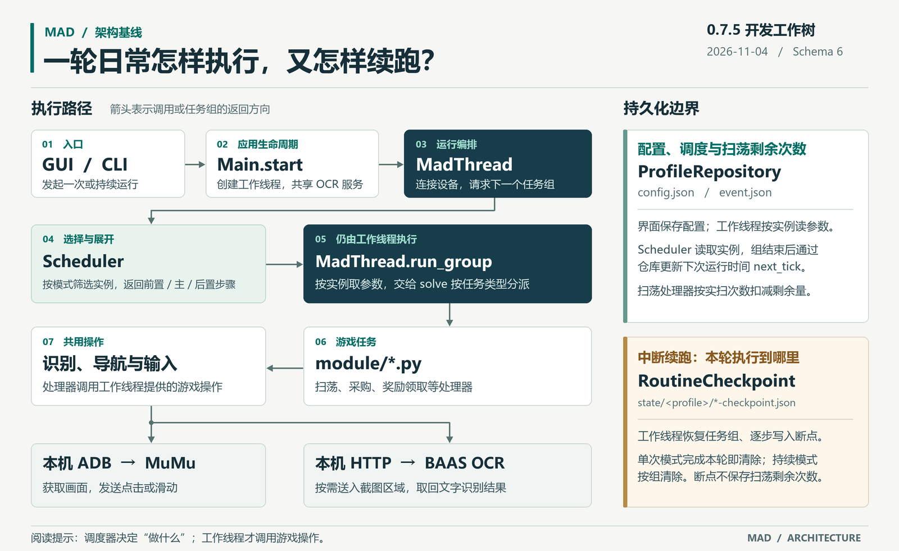
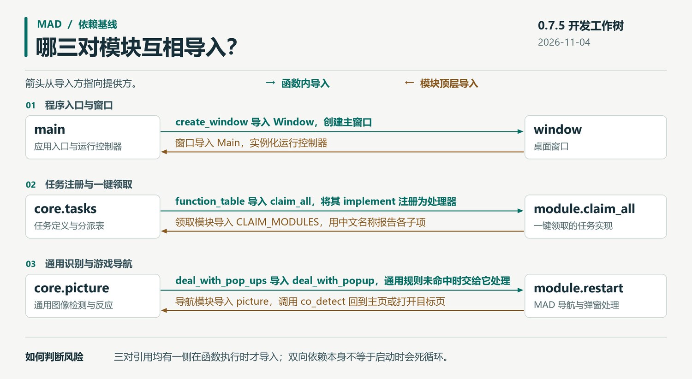

# MADAutoScript 架构现状基线 · 2026-11-04

**结论：保留一条执行链。** GUI 和 CLI 都由 `Main` 启动 `MadThread`。调度器回答“运行哪一组指令”，工作线程回答“用哪一份实例参数执行、何时记账和续跑”。后续的计划模式可以在选择游戏日和当日配置处接入，无须再造一套扫荡、领奖或设备控制流程。当前实现中并没有日历执行器。

## 这份基线指向哪个版本？

- 对象：MADAutoScript 独立源码仓库的 **0.7.5 开发工作树，配置 schema 6**。基准提交为 `main@567c8981c41526f43c0a12c7d0a406d1e82e3011`。快照包含相对 HEAD 的 16 份已修改文件及 5 份相关未跟踪文件；其中有多指令实例、执行断点及测试，另有尚未实施的计划模式设计。单独检出这个提交不能复原当前行为。
- 冻结目录为工作区内的 `MADAutoScript基线/2026-11-04/`：`source/` 保留 139 个工作树文件及独立的 `.codegraph/`；`snapshot.json` 逐项列出来源；`evidence/` 保留五次图查询输出与独立清单；`report/` 是本报告、图和比照工具的副本。原仓库没有建索引。未复制玩家配置、进度、日志、截图、模拟器、Python/OCR 二进制或 Git 历史。
- 两种统计有不同分母。CodeGraph 1.6.2 对快照索引了 **72 个文件（71 Python、1 YAML），1,015 个节点、2,513 条边**，包括测试和维护代码。另用发行构建器从 `main`、`window` 选择的应用 Python 文件做 AST 清单：**58 个模块、133 对显式运行时第一方导入**。后者不含外部包、仅类型检查的引用和动态调用；不是 CodeGraph 调用图的边数。

## 图 1：执行与持久化



| 职责 | 现有实现 | 与邻层的实际关系 |
| --- | --- | --- |
| 入口与工作台 | `main.py`、`window.py`、`gui/fragments/` | GUI 保存指令与调度，通过 `Main.start` 发起执行；CLI 使用相同入口。运行事件经 Qt 信号回到卡片和日志。 |
| 运行编排 | `core/Mad_thread.py` | 连接设备、建立截图与识别上下文、驱动调度、展开的步骤执行及异常恢复。实例编号选择参数和进度，任务类型选择处理函数。 |
| 任务选择 | `core/scheduler.py` | 单次按顺序，持续模式按到期时间和禁用时段筛选；持续跟随在父指令后展开。组结束后通过仓库写回下次到期时间。 |
| 玩法与登记 | `core/tasks.py`、`core/game_catalog.py`、`module/` | 类型表登记可执行函数；任务接收同一个 worker，用其导航、识别、输入和配置能力。普通/学院类扫荡共用 `run_plans`；一键领取组合多个子功能。 |
| 识别与设备 | `core/picture.py`、`mad_features.py`、`image.py`、`core/device/`、`core/ocr/` | 识别规则读取截图、模板和区域 OCR；ADB 对指定 MuMu 发送输入、采集画面；本机 HTTP 请求 OCR 服务。玩法与这些能力间仍通过具体 worker 协作。 |
| 存储与恢复 | `core/config/repository.py`、`core/routine_checkpoint.py`、`core/runtime_state.py` | 仓库管理配置、调度、迁移及扫荡剩余次数；断点管理这一轮已通过哪些步骤；运行日志和结果另存。 |

**用首扫 → 领奖 → 尾扫解释三个状态。** 首扫在游戏显示结算后通过 `complete_sweep` 扣减该**实例**的剩余次数（`config.json`）。领取处理结束后，worker 把已通过的**步骤**写入本轮 checkpoint。尾扫调用同一种扫荡函数，但读自己实例的配置和余项。`next_tick`（`event.json`）表达下次到期时间，不表示今天已经全部做完。单次自然结束会清理本轮 checkpoint；目前没有“某个日历日期已经执行完”的永久记录。

**静态图的断点。** `thread_starter → prepare_pass → eligible`、`run_group → solve` 可以直接定位。再下一跳是 `self.func_dict[activity](self)`：实际处理器须由 `function_table()` 对照任务类型。例如 `mad.normal_sweep → normal_sweep.implement → run_plans`。同理，Qt 信号与 `FEATURES` 按名称选择识别规则，不能把搜索不到的静态调用边当成没有行为。详见[图查询摘录](codegraph-findings.md)。

## 图 2：目前并非严格单向的三处边界



| 互引位置 | 成因 | 将来怎样判断是否变差 |
| --- | --- | --- |
| `main ↔ window` | 入口创建窗口；窗口反过来导入运行控制器 `Main`。 | 新增日历页面若开始直接构建 worker，会增加一个执行入口；宜由现有控制器启动。 |
| `core.tasks ↔ module.claim_all` | 类型表注册处理器；领取模块向类型表取子功能名称。 | 日程定义若开始依赖具体领取模块，日历将难以独立加载；日期编排只需知道指令配置。 |
| `core.picture ↔ module.restart` | 通用弹窗检测回退到 MAD 专属处理；游戏导航又使用通用检测。 | 日期归属和排期写入若落到图像识别层，会把日历逻辑绑到具体弹窗；识别层只需向上报告事件。 |

这三组是显式导入图中的相互可达组，每组均有一端是函数内导入，并不等于启动时死循环。另一个更重要的耦合没有表现成环：**任务直接使用 worker 及其仓库**。未来更换“今日进度属于谁”时，要同时核对任务读取、结算写回、调度和断点目录；只在界面上复制七份参数不够。

## 下一个版本怎样比

保留这份日期基线；在新版仓库根目录用相同口径另生成一份清单。以下命令可使用项目的 Python 3.11 解释器：

```powershell
python docs/architecture/2026-11-04/snapshot_inventory.py --project . --output artifacts/architecture-next/inventory.json
python docs/architecture/2026-11-04/compare_inventory.py docs/architecture/2026-11-04/inventory.json artifacts/architecture-next/inventory.json
```

对照工具报告新增/移除的模块、定义、职责层归属、导入对和相互依赖组；仅移动源码行不会产生拓扑差异。分层是本报告的归类：如果添加全新的顶层包，应先对两个版本统一归类再比较。浮现新依赖后，用 CodeGraph 在各自已授权的索引内复查调用者与写入点。示例：在冻结的 `source/` 下运行 `codegraph explore "MadThread.run_group Scheduler.eligible RoutineCheckpoint.finish_pass" --path .`。

计划模式实施后，优先回答三个问题：**① 普通和计划是否仍复用同一任务执行器？② 当日扫荡余项、调度与断点是否写入正确日期，普通配置是否保持独立？③ 首次启动、跨日和恢复是否会重复派发已经结算的动作？** 前两个问题看依赖与读写边界，第三个问题还需要执行测试；总节点数上升或导入数量不变都不能单独回答它们。

**配套资料：** [机器清单](inventory.json) · [生成器](snapshot_inventory.py) · [差异工具](compare_inventory.py) · [执行图 SVG](architecture.svg) · [依赖图 SVG](dependency-boundaries.svg)
